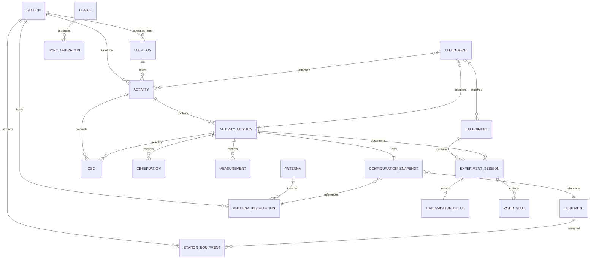

# HRC – Ham Radio Companion
## HRC-DATA – Specifica progettuale del database

**Versione:** 1.0  
**Stato:** Bozza tecnica  
**Database locale:** SQLite  
**ORM:** SQLAlchemy  
**Migrazioni:** Alembic  
**Backend:** Python / FastAPI  
**Architettura:** Modular Monolith  
**Sincronizzazione:** Offline-first con Outbox

---

# 1. Obiettivi

Il database HRC deve supportare:

- Gestione delle stazioni radioamatoriali.
- Gestione di apparati, antenne e installazioni.
- QSO Logbook.
- Attività operative e sessioni portable.
- Esperimenti e misure scientifiche.
- Importazione dati da software radioamatoriali.
- Gestione degli allegati.
- Reporting ed esportazione.
- Sincronizzazione tra più dispositivi.

Il modello deve consentire l'aggiunta progressiva di moduli senza modificare continuamente le entità fondamentali.

## 1.1 Principi progettuali

1. Normalizzazione relazionale.
2. Identificativi UUID.
3. Timestamp UTC.
4. Unità di misura esplicite.
5. Integrità referenziale.
6. Tracciabilità delle modifiche.
7. Conservazione delle configurazioni storiche.
8. Supporto alla sincronizzazione distribuita.
9. Separazione dei dati operativi dai dati sperimentali.
10. Nessuna dipendenza obbligatoria da apparati fisicamente collegati.

---

# 2. Organizzazione logica

Il database viene suddiviso in otto aree funzionali.

| Area | Responsabilità |
|---|---|
| Core | Identità, dispositivi, sincronizzazione |
| Station | Stazioni, apparati, antenne |
| Logbook | QSO e riferimenti radio |
| Field | Attività, sessioni, diario |
| Experiment | Esperimenti e protocolli |
| Measurement | Misure e osservazioni |
| Attachments | Metadati e gestione file |
| Digital & Propagation | Spot, dati digitali e propagazione |

I moduli applicativi non dovranno accedere direttamente alle tabelle degli altri moduli: utilizzeranno servizi applicativi e interfacce definite dall'architettura.

# 3. Diagramma ER generale

Il diagramma seguente rappresenta le relazioni principali. È una vista concettuale: non contiene ancora tutti gli attributi e i vincoli fisici.



La relazione tra esperimento e sessione operativa consente di mantenere separati il contesto sperimentale e l'attività concreta svolta sul campo.

# 4. Convenzioni del database

## 4.1 Identificativi

Tutte le entità principali avranno una chiave primaria UUID.

Esempio concettuale:

`550e8400-e29b-41d4-a716-446655440000`

Vantaggi:

- Identificativi univoci tra dispositivi.
- Nessuna dipendenza da ID autoincrementali locali.
- Migliore gestione della sincronizzazione.
- Possibilità di importare record da altre installazioni.

## 4.2 Timestamp

Tutti i timestamp saranno memorizzati in UTC.

Formato consigliato: ISO 8601.

Esempio:

`2026-11-24T20:30:00Z`

Le date e gli orari saranno convertiti nel fuso locale solo in fase di visualizzazione.

I QSO manterranno i riferimenti temporali UTC richiesti dal formato ADIF.

## 4.3 Grandezze fisiche

| Grandezza | Unità interna |
|---|---|
| Frequenza | Hz |
| Potenza | W |
| Potenza RF | dBm, quando appropriato |
| Distanza | m |
| Lunghezza | m |
| Altezza | m |
| Temperatura | °C |
| Angolo | gradi |
| Impedenza | Ω |
| SWR | adimensionale |
| Coordinate | gradi decimali WGS84 |
| SNR | dB |

I valori visualizzati potranno utilizzare unità più leggibili, come MHz e km.

Ogni misura dovrà conservare unità, origine, timestamp e strumento.

## 4.4 Campi comuni delle entità sincronizzabili

Ogni entità sincronizzabile avrà:

| Campo | Tipo logico | Descrizione |
|---|---|---|
| id | UUID | Chiave primaria |
| created_at | DateTime UTC | Creazione |
| updated_at | DateTime UTC | Ultima modifica |
| deleted_at | DateTime UTC nullable | Cancellazione logica |
| version | Integer | Versione del record |
| origin_device_id | UUID | Dispositivo di origine |
| sync_status | Enum | Stato sincronizzazione |

Stati:

- PENDING
- IN_PROGRESS
- SYNCED
- FAILED
- CONFLICT

Questi campi saranno gestiti centralmente, evitando implementazioni differenti nei singoli moduli.

# 5. Modulo Core

## 5.1 DEVICE

Rappresenta un'installazione di HRC.

| Campo | Tipo | Vincolo |
|---|---|---|
| id | UUID | PK |
| device_name | String | NOT NULL |
| platform | String | NOT NULL |
| application_version | String | NOT NULL |
| last_seen_at | DateTime | NULL |
| created_at | DateTime | NOT NULL |

Esempi:

- Notebook Windows principale.
- Secondo notebook.
- Installazione HRC su altro dispositivo.

Il device ID sarà generato localmente e non dipenderà dall'indirizzo IP o dal nome del computer.

## 5.2 SYNC_OPERATION

Registra le operazioni di sincronizzazione.

| Campo | Tipo | Descrizione |
|---|---|---|
| id | UUID | PK |
| device_id | UUID | FK DEVICE |
| entity_type | String | Tipo entità |
| entity_id | UUID | Record interessato |
| operation_type | Enum | CREATE / UPDATE / DELETE |
| payload | JSON | Dati dell'operazione |
| status | Enum | Stato |
| retry_count | Integer | Tentativi |
| created_at | DateTime | Creazione |
| processed_at | DateTime | Elaborazione |
| error_message | Text | Eventuale errore |

La Outbox dovrà essere aggiornata nella stessa transazione che modifica il record applicativo.

Non dovrà essere possibile salvare un record sincronizzabile senza registrare la relativa operazione Outbox.

La coda deve supportare:

- Retry.
- Idempotenza.
- Deduplicazione.
- Gestione errori.
- Tracciamento degli esiti.

# 6. Modulo Station Manager

## 6.1 STATION

Rappresenta una stazione radioamatoriale.

| Campo | Tipo | Descrizione |
|---|---|---|
| id | UUID | PK |
| callsign | String | Nominativo |
| name | String | Nome stazione |
| description | Text | Descrizione |
| default_location_id | UUID | FK LOCATION, nullable |
| is_primary | Boolean | Stazione principale |

Una installazione HRC potrà gestire più stazioni.

## 6.2 EQUIPMENT

Rappresenta un apparato radio o uno strumento.

| Campo | Tipo |
|---|---|
| id | UUID |
| manufacturer | String |
| model | String |
| serial_number | String, nullable |
| equipment_type | Enum |
| frequency_min_hz | Integer, nullable |
| frequency_max_hz | Integer, nullable |
| max_power_w | Decimal, nullable |
| impedance_ohm | Decimal, nullable |
| description | Text |
| notes | Text |

Tipologie iniziali:

- TRANSCEIVER
- RECEIVER
- TRANSMITTER
- ANTENNA_ANALYZER
- SDR
- POWER_METER
- OTHER

Le caratteristiche specifiche di ogni famiglia di strumenti potranno essere estese senza riempire la tabella di campi non applicabili.

## 6.3 STATION_EQUIPMENT

Tabella associativa tra stazione e apparati.

| Campo | Tipo |
|---|---|
| id | UUID |
| station_id | UUID FK |
| equipment_id | UUID FK |
| valid_from | DateTime |
| valid_to | DateTime, nullable |
| notes | Text |

Consente di mantenere lo storico degli apparati assegnati alla stazione.

## 6.4 ANTENNA

Rappresenta un'antenna.

| Campo | Tipo |
|---|---|
| id | UUID |
| name | String |
| manufacturer | String, nullable |
| model | String, nullable |
| antenna_type | Enum |
| impedance_ohm | Decimal, nullable |
| max_power_w | Decimal, nullable |
| gain_db | Decimal, nullable |
| polarization | Enum, nullable |
| frequency_min_hz | Integer, nullable |
| frequency_max_hz | Integer, nullable |
| dimensions_json | JSON, nullable |
| notes | Text |

Tipologie iniziali:

- DIPOLE
- VERTICAL
- LONGWIRE
- EFHW
- LOOP
- YAGI
- MAGNETIC_LOOP
- OTHER

## 6.5 LOCATION

Rappresenta una località operativa.

| Campo | Tipo |
|---|---|
| id | UUID |
| name | String |
| country | String |
| region | String, nullable |
| province | String, nullable |
| municipality | String, nullable |
| latitude | Decimal, nullable |
| longitude | Decimal, nullable |
| maidenhead_locator | String, nullable |
| altitude_m | Decimal, nullable |
| notes | Text |

Il locator Maidenhead sarà conservato come dato originale.

Le coordinate non dovranno essere utilizzate per ricostruire un locator quando è già disponibile il valore originale, senza conservare anche il valore iniziale.

## 6.6 ANTENNA_INSTALLATION

Rappresenta una configurazione fisica dell'antenna in una determinata località.

| Campo | Tipo |
|---|---|
| id | UUID |
| station_id | UUID FK |
| antenna_id | UUID FK |
| location_id | UUID FK |
| installation_name | String |
| height_m | Decimal, nullable |
| azimuth_deg | Decimal, nullable |
| coax_type | String, nullable |
| coax_length_m | Decimal, nullable |
| choke_description | Text, nullable |
| balun_unun_description | Text, nullable |
| radial_configuration | Text, nullable |
| valid_from | DateTime |
| valid_to | DateTime, nullable |
| notes | Text |

Una stessa antenna può essere installata in località e configurazioni differenti.

# 7. Configurazione storica

Questa sezione è fondamentale per la qualità dei dati sperimentali.

## 7.1 CONFIGURATION_SNAPSHOT

Rappresenta una fotografia immutabile della configurazione effettivamente utilizzata.

| Campo | Tipo |
|---|---|
| id | UUID |
| station_id | UUID FK |
| equipment_id | UUID FK |
| antenna_installation_id | UUID FK, nullable |
| snapshot_data | JSON |
| snapshot_hash | String |
| captured_at | DateTime UTC |

Il campo snapshot_data conserva i parametri tecnici al momento della sessione.

Esempi:

- Marca e modello dell'apparato.
- Potenza massima dichiarata.
- Modello antenna.
- Installazione.
- Lunghezza cavo.
- Configurazione choke.
- Radiali.
- Altezza.
- Note tecniche.

La fotografia storica non sarà modificabile dopo la creazione.

Le modifiche successive alle schede EQUIPMENT e ANTENNA non dovranno alterare gli snapshot esistenti.

Questa scelta evita che un esperimento del passato cambi significato quando si aggiorna una scheda tecnica.

# 8. Modulo QSO Logbook

## 8.1 QSO

Tabella principale del registro.

| Campo | Tipo | Vincolo / descrizione |
|---|---|---|
| id | UUID | PK |
| station_id | UUID | FK STATION |
| activity_id | UUID | FK ACTIVITY, nullable |
| activity_session_id | UUID | FK ACTIVITY_SESSION, nullable |
| configuration_snapshot_id | UUID | FK SNAPSHOT, nullable |
| callsign | String | NOT NULL |
| qso_datetime_utc | DateTime | NOT NULL |
| frequency_hz | Integer | NOT NULL |
| band_id | UUID | FK BAND_DEFINITION |
| mode_id | UUID | FK MODE_DEFINITION |
| rst_sent | String | Nullable |
| rst_received | String | Nullable |
| operator_name | String | Nullable |
| qth | String | Nullable |
| locator | String | Nullable |
| country | String | Nullable |
| power_w | Decimal | Nullable |
| comments | Text | Nullable |
| source | Enum | Origine record |
| adif_import_id | UUID | Nullable |

### Regola banda/frequenza

L'inserimento segue la decisione UX:

1. L'utente seleziona la banda.
2. Il sistema propone l'intervallo di frequenza valido.
3. L'utente inserisce la frequenza.
4. Il sistema verifica la coerenza.
5. Il record viene salvato.

La banda non sarà dedotta automaticamente come unica modalità di inserimento.

Il database conserverà sia band_id sia frequency_hz.

La validazione dovrà considerare il piano di banda configurato e la sua validità temporale, evitando di assumere che un intervallo sia universale per ogni regione e servizio.

### Dati RST

RST sarà conservato come stringa, non come numero intero, perché il formato dipende dal modo operativo.

### Provenienza del QSO

Valori iniziali:

- MANUAL
- ADIF_IMPORT
- WSJT_X
- OTHER

## 8.2 BAND_DEFINITION

Tabella delle bande operative.

| Campo | Tipo |
|---|---|
| id | UUID |
| name | String |
| frequency_min_hz | Integer |
| frequency_max_hz | Integer |
| region | String |
| valid_from | Date, nullable |
| valid_to | Date, nullable |

La gestione delle bande sarà configurabile.

## 8.3 MODE_DEFINITION

| Campo | Tipo |
|---|---|
| id | UUID |
| name | String |
| category | String |
| adif_code | String, nullable |

Esempi:

- SSB
- USB
- LSB
- CW
- FT8
- FT4
- WSPR
- RTTY
- PSK31
- JS8

I codici ADIF dovranno essere mappati secondo le specifiche del formato.

## 8.4 ADIF_IMPORT

Registra le importazioni.

| Campo | Tipo |
|---|---|
| id | UUID |
| filename | String |
| file_hash | String |
| imported_at | DateTime |
| total_records | Integer |
| valid_records | Integer |
| duplicate_records | Integer |
| rejected_records | Integer |
| import_status | Enum |

Serve per tracciare l'origine dei dati e diagnosticare eventuali importazioni ripetute.

# 9. Modulo Field Operations

## 9.1 ACTIVITY

Rappresenta un'attività radioamatoriale.

| Campo | Tipo |
|---|---|
| id | UUID |
| station_id | UUID FK |
| location_id | UUID FK |
| name | String |
| activity_type | Enum |
| description | Text |
| planned_start_at | DateTime, nullable |
| planned_end_at | DateTime, nullable |
| status | Enum |
| notes | Text |

Tipologie:

- PORTABLE_HF
- POTA
- SOTA
- ANTENNA_TEST
- PROPAGATION_TEST
- RECEPTION
- OTHER

Stati:

- PLANNED
- IN_PROGRESS
- SUSPENDED
- COMPLETED
- ARCHIVED

## 9.2 ACTIVITY_SESSION

Rappresenta una sessione operativa appartenente a un'attività.

| Campo | Tipo |
|---|---|
| id | UUID |
| activity_id | UUID FK |
| configuration_snapshot_id | UUID FK |
| started_at | DateTime |
| ended_at | DateTime, nullable |
| suspended_at | DateTime, nullable |
| status | Enum |
| power_w | Decimal, nullable |
| notes | Text |

### Vincolo progettuale

Ogni sessione avrà una sola configurazione operativa.

Una sessione non potrà cambiare apparato o antenna senza terminare e creare una nuova sessione.

Questo consente di associare con certezza i QSO e le misure alla configurazione realmente utilizzata.

Per confrontare due antenne nello stesso esperimento si utilizzeranno sessioni distinte.

## 9.3 ACTIVITY_EVENT

Registro cronologico della sessione.

| Campo | Tipo |
|---|---|
| id | UUID |
| activity_session_id | UUID FK |
| event_type | Enum |
| event_datetime | DateTime |
| description | Text |
| data_json | JSON, nullable |

Tipi iniziali:

- SESSION_STARTED
- SESSION_SUSPENDED
- SESSION_RESUMED
- NOTE_ADDED
- MEASUREMENT_RECORDED
- QSO_RECORDED
- ATTACHMENT_ADDED
- SESSION_COMPLETED

L'ordine cronologico sarà determinato dal timestamp, con ID come criterio secondario quando necessario.

## 9.4 OBSERVATION

Raccoglie osservazioni qualitative e contestuali.

| Campo | Tipo |
|---|---|
| id | UUID |
| activity_session_id | UUID FK |
| observed_at | DateTime |
| observation_type | String |
| description | Text |
| source | String, nullable |

Esempi:

- Rumore RF percepito.
- Condizioni meteorologiche.
- Disturbi locali.
- Variazioni ambientali.
- Anomalie operative.

Le osservazioni non devono essere confuse con le misurazioni strumentali.

# 10. Modulo Experiment

## 10.1 EXPERIMENT

Rappresenta un progetto sperimentale.

| Campo | Tipo |
|---|---|
| id | UUID |
| name | String |
| objective | Text |
| hypothesis | Text |
| protocol | Text |
| start_date | Date, nullable |
| end_date | Date, nullable |
| status | Enum |
| conclusion | Text |

Stati:

- PLANNED
- ACTIVE
- COMPLETED
- ARCHIVED

## 10.2 EXPERIMENT_SESSION

Collega una sessione operativa a un esperimento.

| Campo | Tipo |
|---|---|
| id | UUID |
| experiment_id | UUID FK |
| activity_session_id | UUID FK UNIQUE |
| session_label | String |
| sequence_number | Integer |
| notes | Text |

La relazione UNIQUE impedisce che una stessa sessione operativa venga associata accidentalmente a più sessioni sperimentali.

Un esperimento può avere molte sessioni.

Ogni sessione sperimentale eredita la configurazione unica della propria sessione operativa.

## 10.3 TRANSMISSION_BLOCK

Rappresenta un intervallo di trasmissione controllato all'interno di una sessione sperimentale.

| Campo | Tipo |
|---|---|
| id | UUID |
| experiment_session_id | UUID FK |
| start_at | DateTime |
| end_at | DateTime |
| frequency_hz | Integer |
| band_id | UUID FK |
| mode_id | UUID FK |
| power_w | Decimal, nullable |
| sequence_number | Integer |
| notes | Text |

L'antenna non è duplicata nel blocco: è già determinata dallo snapshot della sessione.

Questo impedisce incongruenze tra antenna dichiarata nel blocco e antenna effettivamente utilizzata nella sessione.

# 11. Modulo Measurement

## 11.1 MEASUREMENT

Rappresenta una misura strumentale.

| Campo | Tipo |
|---|---|
| id | UUID |
| activity_session_id | UUID FK |
| experiment_session_id | UUID FK, nullable |
| measurement_type | Enum |
| measured_at | DateTime |
| value | Decimal |
| unit | String |
| instrument_equipment_id | UUID FK, nullable |
| source | String |
| uncertainty | Decimal, nullable |
| uncertainty_unit | String, nullable |
| notes | Text |

Tipi iniziali:

- SWR
- POWER
- FREQUENCY
- IMPEDANCE
- RESISTANCE
- REACTANCE
- SNR
- TEMPERATURE
- VOLTAGE
- CURRENT
- OTHER

### Regole metrologiche

Ogni misura dovrà poter documentare:

- Grandezza misurata.
- Valore.
- Unità.
- Timestamp.
- Strumento.
- Fonte.
- Incertezza, quando disponibile.
- Configurazione operativa.

Le misure saranno trattate come eventi storici: non dovranno essere sovrascritte per correggere un dato. Una correzione dovrà essere tracciata.

## 11.2 DATA_IMPORT

Registro delle importazioni di dataset.

| Campo | Tipo |
|---|---|
| id | UUID |
| filename | String |
| source_type | String |
| file_hash | String |
| imported_at | DateTime |
| record_count | Integer |
| import_status | Enum |
| notes | Text |

Utile per importazioni CSV, WSPR, NanoVNA e dati SDR.

# 12. Modulo Digital & Propagation

## 12.1 WSPR_SPOT

Rappresenta un singolo spot WSPR ricevuto.

| Campo | Tipo |
|---|---|
| id | UUID |
| experiment_session_id | UUID FK, nullable |
| transmission_block_id | UUID FK, nullable |
| tx_callsign | String |
| tx_locator | String, nullable |
| rx_callsign | String |
| rx_locator | String, nullable |
| frequency_hz | Integer |
| band_id | UUID FK |
| snr_db | Decimal |
| tx_power_dbm | Decimal, nullable |
| distance_km | Decimal, nullable |
| azimuth_deg | Decimal, nullable |
| received_at | DateTime |
| source | String |
| source_record_id | String, nullable |

La mancata decodifica non deve essere rappresentata da uno spot con SNR pari a zero.

L'assenza di decodifica è un dato mancante o un evento non osservato, da gestire separatamente.

## 12.2 DIGITAL_EVENT

Tabella per eventi provenienti da software digitali.

| Campo | Tipo |
|---|---|
| id | UUID |
| activity_session_id | UUID FK, nullable |
| received_at | DateTime |
| source_application | String |
| event_type | String |
| callsign | String, nullable |
| frequency_hz | Integer, nullable |
| mode_id | UUID FK, nullable |
| payload_json | JSON |

La tabella potrà accogliere eventi UDP di WSJT-X e altre integrazioni.

# 13. Modulo Attachments

## 13.1 ATTACHMENT

Contiene i metadati degli allegati.

| Campo | Tipo |
|---|---|
| id | UUID |
| original_filename | String |
| stored_filename | String |
| relative_path | String |
| mime_type | String |
| file_size_bytes | Integer |
| sha256_hash | String |
| created_at | DateTime |
| captured_at | DateTime, nullable |
| sync_status | Enum |

## 13.2 ATTACHMENT_LINK

Tabella associativa per collegare un allegato a entità diverse.

| Campo | Tipo |
|---|---|
| id | UUID |
| attachment_id | UUID FK |
| entity_type | String |
| entity_id | UUID |

Esempi:

- QSO.
- Activity.
- ActivitySession.
- Experiment.
- Measurement.
- Antenna.
- Equipment.

L'applicazione dovrà verificare che l'entità di destinazione esista e sia supportata.

### Regola di archiviazione

Quando si aggiunge un allegato:

1. L'utente seleziona il file originale.
2. HRC copia il file nell'archivio gestito.
3. HRC genera un nome interno univoco.
4. Calcola l'hash SHA-256.
5. Registra i metadati.
6. Collega il file all'entità.

Il file originale non viene modificato.

Gli allegati non dovranno essere salvati direttamente nel database SQLite come BLOB nella prima versione.

La sincronizzazione dei file sarà gestita separatamente dalla sincronizzazione dei record.

# 14. Indici e vincoli

Gli indici iniziali dovranno privilegiare le ricerche più frequenti.

## 14.1 QSO

- callsign
- qso_datetime_utc
- band_id
- mode_id
- frequency_hz
- activity_id
- activity_session_id

## 14.2 Activity

- status
- activity_type
- planned_start_at
- location_id

## 14.3 ActivitySession

- activity_id
- started_at
- status
- configuration_snapshot_id

## 14.4 Measurement

- activity_session_id
- experiment_session_id
- measurement_type
- measured_at

## 14.5 WSPR_SPOT

- rx_callsign
- tx_callsign
- received_at
- band_id
- experiment_session_id
- transmission_block_id

## 14.6 Sincronizzazione

- sync_status
- updated_at
- origin_device_id
- status della Outbox
- created_at della Outbox

## 14.7 Vincoli

- PK UUID su tutte le entità.
- FK con integrità referenziale.
- NOT NULL sui campi essenziali.
- UNIQUE sulle relazioni che devono essere univoche.
- CHECK sui valori numerici e sugli intervalli ammessi.
- Soft delete sulle entità sincronizzabili.
- Divieto di cancellazione fisica di record con riferimenti storici.

# 15. Regole di integrità e comportamento

## 15.1 QSO

Un QSO deve essere associato a una stazione.

Può essere associato a un'attività e, facoltativamente, a una sessione.

Se è associato a una sessione, deve essere coerente con la stazione e la configurazione storica della sessione.

## 15.2 Sessioni

Una sessione deve avere una sola configurazione storica.

Una modifica della configurazione comporta la chiusura della sessione corrente e la creazione di una nuova sessione.

## 15.3 Esperimenti

Un esperimento può contenere più sessioni.

Ogni sessione può avere una sola configurazione.

Un confronto tra antenne sarà quindi costituito da più sessioni distinte.

## 15.4 Misure

Le misure sono eventi storici e non devono cambiare retroattivamente quando cambia l'apparato o l'antenna.

## 15.5 Cancellazioni

Le cancellazioni saranno logiche.

La cancellazione fisica sarà riservata a operazioni amministrative controllate e non dovrà compromettere la sincronizzazione.

# 16. Strategia di sincronizzazione

## 16.1 Transazione locale

Quando viene creato un QSO:

1. HRC inserisce il QSO.
2. HRC registra l'evento Outbox.
3. HRC completa la transazione SQLite.
4. Entrambi i record diventano persistenti oppure nessuno dei due viene salvato.

La stessa regola vale per le altre entità sincronizzabili.

## 16.2 Conflitti

Non sarà utilizzato un criterio globale Last Write Wins.

Regole iniziali:

- Anagrafiche: risoluzione esplicita dei conflitti.
- QSO: deduplicazione e confronto dei dati.
- Misure: conservazione dei record originali.
- WSPR spot: deduplicazione tramite identificativi e campi di provenienza.
- Allegati: verifica tramite hash.
- Cancellazioni: propagazione tramite tombstone.

## 16.3 Allegati

La sincronizzazione degli allegati avverrà dopo la registrazione dei metadati.

Il trasferimento dovrà verificare:

- Hash.
- Dimensione.
- Integrità.
- Presenza del file sul dispositivo remoto.

# 17. Organizzazione fisica SQLite

Il database locale sarà un file dedicato.

Esempio di archivio:

```text
HRC_DATA/
│
├── database/
│   └── hrc.sqlite
│
├── attachments/
│   ├── 2026/
│   │   ├── 01/
│   │   ├── 02/
│   │   └── 11/
│   │
│   └── ...
│
├── backups/
│
├── exports/
│
└── logs/
```

Il percorso effettivo sarà configurabile.

Il database SQLite non dovrà essere aperto e modificato simultaneamente attraverso cartelle sincronizzate da OneDrive, Google Drive o servizi analoghi.

La sincronizzazione dei dati sarà gestita dall'applicazione.

# 18. Migrazioni e versionamento

Alembic gestirà tutte le modifiche dello schema.

Ogni modifica strutturale dovrà:

1. Essere rappresentata da una migrazione.
2. Essere verificabile.
3. Essere reversibile quando tecnicamente possibile.
4. Non compromettere i dati esistenti.
5. Essere testata su un database di prova.

Il numero di versione dello schema sarà indipendente dalla versione dell'applicazione.

# 19. Strategia di implementazione

La realizzazione sarà progressiva.

| Fase | Tabelle principali |
|---|---|
| Core | DEVICE, SYNC_OPERATION |
| Station | STATION, EQUIPMENT, STATION_EQUIPMENT, ANTENNA, LOCATION, ANTENNA_INSTALLATION |
| Storico | CONFIGURATION_SNAPSHOT |
| Logbook | QSO, BAND_DEFINITION, MODE_DEFINITION, ADIF_IMPORT |
| Field | ACTIVITY, ACTIVITY_SESSION, ACTIVITY_EVENT, OBSERVATION |
| Experiment | EXPERIMENT, EXPERIMENT_SESSION, TRANSMISSION_BLOCK |
| Measurement | MEASUREMENT, DATA_IMPORT |
| Attachments | ATTACHMENT, ATTACHMENT_LINK |
| Digital | WSPR_SPOT, DIGITAL_EVENT |

Le tabelle potranno essere introdotte in migrazioni distinte, mantenendo fin dall'inizio la struttura complessiva coerente.

# 20. Criteri di accettazione HRC-DATA

La progettazione del database sarà considerata completa quando:

1. Tutte le entità principali saranno definite.
2. Ogni relazione avrà cardinalità e vincoli documentati.
3. Tutte le chiavi primarie saranno definite.
4. Tutte le unità di misura saranno esplicite.
5. La gestione UTC sarà uniforme.
6. Le configurazioni storiche saranno immutabili.
7. La sessione avrà una sola configurazione.
8. Il modello QSO sarà compatibile con ADIF.
9. Gli allegati saranno gestiti esternamente a SQLite.
10. La Outbox sarà progettata per operazioni atomiche.
11. I vincoli di integrità saranno documentati.
12. Le migrazioni saranno previste fin dalla prima versione.

---

**Fine documento HRC-DATA v1.0 – Specifica progettuale del database**
